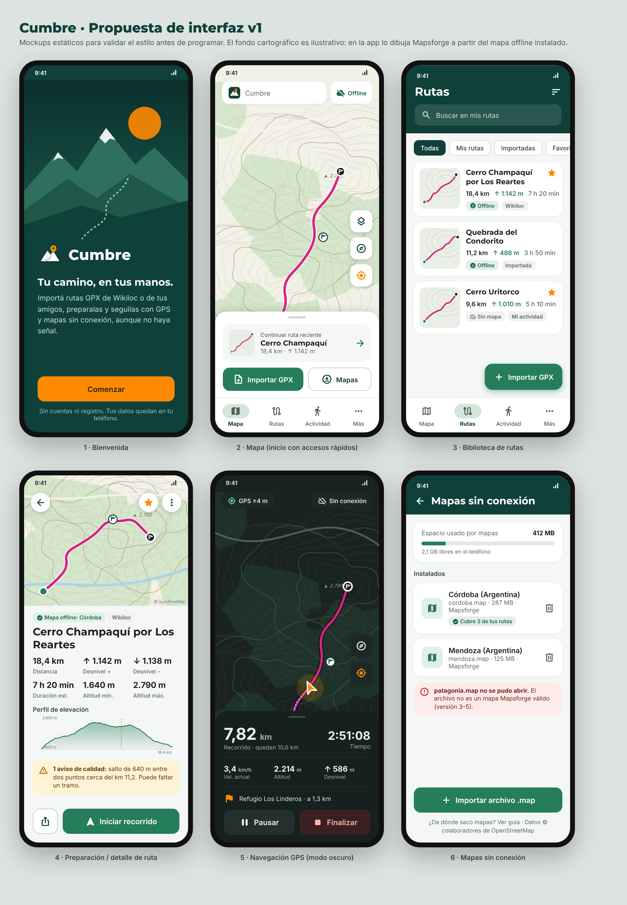

# Cumbre

**Tu camino, en tus manos.**

Cumbre es una app Android de trekking. Convierte rutas encontradas en Wikiloc, o recibidas como archivo GPX, en recorridos listos para seguir con GPS y mapas sin conexión. Está pensada para funcionar en la montaña, donde no hay señal de celular.

- Sin cuenta ni registro.
- Sin publicidad, sin servicios pagos y sin claves de API.
- **Sin permiso de Internet**: tus rutas, recorridos y ubicación no salen del teléfono.



---

## Funcionalidades implementadas

### Rutas GPX
- **Importación** desde el selector de archivos, con «Abrir con Cumbre» y «Compartir con Cumbre» desde otras apps (gestores de archivos, navegador, mensajería, Wikiloc).
- **Lectura segura y por streaming** de GPX 1.0 y 1.1: tracks, segmentos, rutas (`rte`), waypoints, elevaciones, marcas de tiempo, nombres, descripciones, enlaces y metadatos.
  - Rechaza `DOCTYPE` y entidades externas (protección XXE).
  - Límites: 50 MB por archivo y un millón de puntos.
  - El análisis corre fuera del hilo principal.
- **Los segmentos se conservan separados**: no se suman distancias ni desniveles entre tramos distintos.
- **Validación**: coordenadas fuera de rango, archivos vacíos, dañados o truncados, XML que no es GPX y archivos sin geometría. Cada error muestra un mensaje claro y no cierra la app.
- **Preparación del recorrido**, antes de guardar:
  - mapa del track, con inicio y final;
  - distancia, desnivel positivo y negativo, altitud mínima y máxima;
  - cantidad de puntos y tramos;
  - duración estimada (norma DIN 33466) y tiempo real registrado si el archivo lo trae;
  - perfil de elevación y waypoints.
- **Avisos de calidad**:
  - coordenadas inválidas descartadas;
  - segmentos vacíos;
  - archivos sin altitud o con altitud parcial;
  - saltos de más de 1 km entre puntos consecutivos, con su kilómetro;
  - tramos separados;
  - archivo sin nombre.
- **Detección de duplicados** mediante una huella de la geometría. El mismo recorrido con otro nombre o formato no se duplica.
- **Biblioteca** con las categorías Todas, Mis rutas, Importadas, Favoritas y Recientes.
  - Búsqueda sin tildes.
  - Filtros por distancia, desnivel y duración, y cuatro órdenes posibles.
  - Miniaturas dibujadas a partir del track real.
  - Indicador de disponibilidad de mapa offline.
- **Detalle de ruta**:
  - iniciar el recorrido;
  - marcar como favorita y cambiar el nombre;
  - exportar GPX (Storage Access Framework) y compartir el archivo;
  - editar el enlace de origen y abrirlo en Wikiloc;
  - eliminar, con confirmación;
  - comprobar qué mapas instalados cubren la ruta.

### Navegación GPS
- **Seguimiento de una ruta importada**:
  - distancia recorrida y restante, medida a lo largo del track real;
  - tiempo, velocidad actual y media, altitud y desnivel estimado;
  - distancia al siguiente waypoint por el track.
- **Distancia a la ruta** calculada sobre la geometría real. En recorridos de ida y vuelta, la búsqueda por ventana evita que el progreso salte al tramo de regreso.
- **Aviso de desvío** configurable (25, 50, 100 o 200 m), con vibración y notificación. Usa histéresis y exige tres lecturas para no dar falsas alarmas.
- **Indicador de señal GPS**: buscando, buena, débil o perdida, con la precisión en metros. Si se pierde la señal se muestra la última posición atenuada y no se graban puntos.
- **Controles**: centrar en la posición, orientar el mapa según el rumbo, pausar y reanudar, y finalizar o descartar con confirmación.
- **Pantalla encendida** durante la grabación (configurable).
- **No inventa indicaciones de giro**: se muestra la línea del GPX y la posición respecto de ella.

### Grabación de actividades
- Grabación libre o mientras se sigue una ruta, con un **servicio en primer plano de tipo `location`**: sigue funcionando con la pantalla apagada o la app en segundo plano.
- **Filtro de ruido GPS**: descarta lecturas imprecisas (más de 35 m), desordenadas, saltos imposibles y el temblor estando quieto, sin ocultar desplazamientos reales.
- **Cada punto se guarda en Room al recibirse.** Si Android cierra el proceso:
  - el servicio se reinicia y retoma la grabación;
  - si eso no es posible, al abrir la app se ofrece continuar, guardar o descartar la actividad.
- **Historial** con totales. **Detalle** con mapa, estadísticas y perfil de altitud.
- Exportar a GPX (las pausas quedan como tramos separados), compartir, cambiar el nombre, eliminar y **guardar como ruta propia** en «Mis rutas».

### Mapas sin conexión
- Mapas vectoriales **Mapsforge (`.map`)** renderizados en el teléfono, sin Internet.
- **Importación** de archivos `.map`:
  - validación de la cabecera y lectura del área cubierta, la versión y la fecha de los datos;
  - control de espacio libre y barra de progreso.
- **Gestión**: varios mapas combinados, activar o desactivar cada uno, eliminar con confirmación, ver el espacio usado y el libre, y detección de archivos borrados o ilegibles.
- **Cobertura del recorrido** (completa, parcial o ninguna) en la biblioteca y en el detalle de cada ruta.
- **Dos estilos de mapa**: Cumbre (predeterminado) y Osmarender.
- **Sin mapa instalado** se ve el track y la posición sobre un fondo liso, con un aviso. Nunca se simula cartografía.

### Wikiloc
- Guía paso a paso y botón para abrir la web oficial de Wikiloc en el navegador.
- Si se comparte un enlace de Wikiloc con Cumbre, se guarda y se asocia automáticamente al próximo GPX importado.
- El enlace de origen se detecta también desde los metadatos del GPX y se puede editar en cada ruta.

### Privacidad y datos
- **Exportar todo** a un ZIP con todas las rutas y actividades en GPX.
- **Eliminar todos los datos**, con la opción de borrar también los mapas.
- **Permisos progresivos**: la ubicación se pide recién al usar el GPS, con una explicación previa.
  - Se manejan los casos «ubicación aproximada» y «denegado para siempre», con acceso directo a Ajustes.
  - La notificación se pide al iniciar la primera grabación.

### Identidad visual
- Paleta oficial como tokens:
  - verde montaña `#0F403A`, verde bosque `#267D5B`, verde suave `#A7C4B2`;
  - naranja `#FF8A00`, gris oscuro `#1E1E1E`, gris claro `#F5F7F6`, blanco.
- Colores semánticos aparte para error, aviso y éxito. Track en magenta, para distinguirlo del naranja de la posición y del verde del terreno.
- Tipografías **Montserrat** (títulos) e **Inter** (textos y datos), incluidas localmente.
- **Icono adaptativo vectorial** (fondo, primer plano y variante monocromática para iconos temáticos), splash con la API SplashScreen, logo e ilustración de bienvenida en vectores. La fuente del icono está en `docs/marca/cumbre-icono.svg` y hay un PNG de 512 px para tiendas.
- Modo claro, oscuro y «según el sistema».
- Componentes reutilizables: botones, tarjetas, etiquetas, chips, diálogos de confirmación, estados vacíos, mensajes, buscador, panel inferior del mapa y controles flotantes.

---

## Arquitectura

```
appfutura/
├── core/   Módulo Kotlin puro (JVM), sin dependencias de Android: reglas de negocio probadas
│   ├── gpx/          Lector SAX seguro y escritor GPX 1.1
│   ├── analysis/     Distancia, desnivel con histéresis, duración DIN 33466, perfil, avisos, huella
│   ├── geo/          Haversine, proyección sobre segmentos, Douglas-Peucker, polilínea codificada
│   ├── navigation/   Geometría del track, seguimiento, desvío y próximo waypoint
│   ├── recording/    Filtro GPS, estadísticas, reloj con pausas, recuperación, exportación
│   ├── maps/         Validación de archivos Mapsforge y cobertura del recorrido
│   ├── library/      Categorías, filtros y orden de la biblioteca; enlaces de Wikiloc
│   ├── permissions/  Política de permisos progresivos
│   └── format/       Unidades en español de Argentina (km, m, h y min)
└── app/    Aplicación Android (MVVM)
    ├── data/         Room (rutas, waypoints, actividades, puntos, mapas), DataStore, archivos, repositorios
    ├── location/     Ubicación con LocationManager (sin Google Play Services)
    ├── tracking/     TrackingManager (estado compartido) y TrackingService (primer plano)
    ├── map/          Integración de Mapsforge: controlador del MapView y capa de marcadores
    └── ui/           Jetpack Compose + Material 3: tema, componentes, navegación y pantallas
```

- **MVVM** con ViewModels, `StateFlow` y corrutinas. Todo el trabajo de archivos y análisis corre en `Dispatchers.IO` o `Default`.
- **Inyección de dependencias manual** (`AppContainer`): el grafo es chico y no justifica un framework.
- **Navegación**: cuatro destinos principales (Mapa, Rutas, Actividad, Más) con Navigation Compose. El estado se conserva al cambiar de sección (`saveState` y `restoreState`).
- **La actividad en curso vive en `TrackingManager`**, independiente de las pantallas: cambiar de sección no reinicia el GPS.
- **El motor cartográfico de las pantallas Mapa y Navegación se conserva** entre navegaciones (`MapControllerStore`). Las pantallas de detalle crean y liberan el suyo.
- **El GPS se libera** al pausar, al salir de la pantalla del mapa o al pasar a segundo plano, salvo durante una grabación.

## Dependencias principales

| Biblioteca | Uso | Licencia |
|---|---|---|
| Kotlin 2.0.21, kotlinx.coroutines 1.9.0 | Lenguaje y concurrencia | Apache 2.0 |
| Jetpack Compose (BOM 2024.12.01), Material 3 | Interfaz | Apache 2.0 |
| Navigation Compose 2.8.5, Lifecycle 2.8.7 | Navegación y ViewModels | Apache 2.0 |
| Room 2.6.1 (KSP) | Persistencia | Apache 2.0 |
| DataStore Preferences 1.1.1 | Preferencias | Apache 2.0 |
| Core SplashScreen 1.0.1 | Pantalla de inicio | Apache 2.0 |
| Mapsforge 0.25.0 | Mapas vectoriales offline | LGPL 3.0 |
| AndroidSVG 1.4 (vía Mapsforge) | Símbolos de los temas de mapa | Apache 2.0 |
| Montserrat, Inter | Tipografías | SIL OFL 1.1 (`docs/licencias/`) |

El GPX se procesa con un lector propio basado en SAX, la API XML estándar disponible en Android y en la JVM. Así se controlan la seguridad (sin DTD ni entidades externas), la memoria (streaming) y los segmentos, sin dependencias extra.

## Requisitos de compilación

- Android Studio Ladybug (2024.2) o posterior, o la línea de comandos con JDK 17 o superior.
- Android SDK con la plataforma **API 35** (compileSdk y targetSdk 35; minSdk 26, Android 8.0).
- Acceso a Google Maven y Maven Central para descargar las dependencias.

## Cómo abrir y compilar

1. Cloná el repositorio y abrí la carpeta en Android Studio (**File › Open**).
2. Esperá la sincronización de Gradle.
3. Elegí la configuración **app** y un dispositivo o emulador, y tocá **Run**.

### Generar el APK

```bash
./gradlew :app:assembleDebug
# APK: app/build/outputs/apk/debug/app-debug.apk
```

Para publicar, configurá tu propia firma y ejecutá `./gradlew :app:assembleRelease` (R8 y reducción de recursos activados).

### CI

El workflow `.github/workflows/android.yml` ejecuta las pruebas y compila el APK de depuración en cada push. El APK queda como artefacto descargable (`cumbre-debug-apk`) en la pestaña **Actions** de GitHub.

### Pruebas

```bash
./gradlew :core:test              # Reglas de negocio (JVM)
./gradlew :app:connectedAndroidTest   # Persistencia con Room (requiere dispositivo o emulador)
```

El módulo `core` también puede probarse de forma aislada, sin el SDK de Android: `cd core && ../gradlew test`.

Qué cubren las pruebas de `core`:
- **GPX**: lectura de archivos válidos, vacíos y dañados, XML que no es GPX, protección XXE, coordenadas fuera de rango, varios segmentos, archivos sin elevación, límite de tamaño, errores de lectura y fechas.
- **Cálculos**: distancias en metros y desnivel con histéresis.
- **Exportación** GPX ida y vuelta, y detección de duplicados.
- **Seguimiento**: progreso, desvío, recorridos de ida y vuelta y waypoints.
- **Actividades**: filtro GPS, estadísticas y su reconstrucción tras un cierre, reloj con pausas, política de recuperación y señal GPS.
- **Mapas** ausentes o inválidos y cobertura del recorrido.
- **Formato** es-AR, biblioteca, enlaces de Wikiloc y permisos.
- **Manifiesto**: sin Internet y con los permisos mínimos.

---

## Guía de uso

### Importar una ruta GPX
1. En **Mapa** o **Rutas**, tocá **Importar GPX** y elegí el archivo. También podés tocar un `.gpx` en tu gestor de archivos y elegir **Abrir con Cumbre**, o compartirlo con Cumbre desde otra app.
2. Revisá la vista previa: mapa, distancia, desnivel, perfil y avisos de calidad.
3. Cambiá el nombre si querés, agregá el enlace de origen y tocá **Guardar ruta**.

### Incorporar rutas de Wikiloc
1. En **Más › Rutas de Wikiloc**, tocá **Abrir Wikiloc en el navegador**. También podés compartir el enlace de una ruta con Cumbre desde la app de Wikiloc.
2. En Wikiloc, usá **Descargar** y elegí **GPX**. Wikiloc puede pedir iniciar sesión o una suscripción, según sus condiciones vigentes.
3. Abrí el archivo descargado con Cumbre. Si antes compartiste el enlace, se asocia automáticamente a la ruta.

Cumbre **no** hace scraping, no usa endpoints privados, no automatiza sesiones y no guarda contraseñas de Wikiloc. No existe una API pública gratuita para descargar rutas, por eso el flujo principal es el archivo GPX. La app sigue siendo útil aunque la web de Wikiloc cambie.

### Obtener e instalar mapas offline
1. Con Wi-Fi, descargá desde el navegador el mapa `.map` de tu provincia o región:
   - [Servidor oficial de Mapsforge](https://download.mapsforge.org/maps/v5/south-america/) (por ejemplo, `argentina.map`);
   - [OpenAndroMaps](https://www.openandromaps.org/en/downloads/south-america), con mapas orientados a senderismo. Viene en ZIP: descomprimilo y usá el `.map`.
2. En **Más › Mapas sin conexión**, tocá **Importar archivo .map**.
3. Desde ese momento, el mapa se ve sin conexión. El detalle de cada ruta indica si está cubierta.

Cumbre no descarga teselas del servidor público de OpenStreetMap ni hace descargas masivas: los mapas los obtiene el usuario de fuentes que permiten su descarga.

### Seguir una ruta o grabar una actividad
- **Seguir una ruta**: en el detalle de la ruta, tocá **Iniciar recorrido**. La primera vez se explica para qué se usa la ubicación antes de pedirla.
- **Grabar sin ruta**: en **Actividad**, tocá **Iniciar actividad**.
- **Durante el recorrido**:
  - **Pausar** libera el GPS;
  - **Finalizar** guarda la actividad en el historial;
  - se puede volver atrás y usar otras secciones: la grabación continúa.

## Permisos

| Permiso | Para qué |
|---|---|
| Ubicación precisa y aproximada | Mostrar tu posición, seguir rutas y grabar actividades. Se pide al usarla por primera vez. |
| Servicio en primer plano (ubicación) | Seguir grabando con la pantalla apagada, con una notificación visible. |
| Notificaciones | Mostrar el recorrido en curso y los avisos de desvío (Android 13 y posteriores). |
| Vibración | Aviso de desvío. |

**No** se piden Internet, ubicación en segundo plano permanente ni acceso al almacenamiento compartido: los archivos se leen y escriben con el selector del sistema.

## Qué funciona sin Internet

Todo:
- importar, analizar y exportar GPX;
- la biblioteca;
- el GPS, la navegación y la grabación;
- el mapa, si instalaste el `.map` de la zona;
- el historial y la exportación de datos.

Solo los enlaces externos (Wikiloc y las páginas de descarga de mapas) se abren en el navegador y requieren conexión.

## Limitaciones conocidas

- **No hay descarga de mapas dentro de la app.** No encontré una fuente gratuita que permita expresamente la descarga automatizada desde apps de terceros, así que el flujo es descargar con el navegador e importar.
- **No hay indicaciones de giro.** Un GPX es solo una línea; Cumbre no inventa instrucciones.
- **El desnivel de las actividades es estimado** a partir de la altitud GPS (filtro de 10 m), que es menos precisa que la horizontal. No se usa el barómetro.
- **La orientación del mapa según el rumbo** usa el rumbo del GPS. No usa la brújula del teléfono, así que necesita movimiento.
- **No hay relieve sombreado** (hillshading): requiere modelos de elevación aparte.
- **Los textos de la interfaz están en español dentro del código**, no en `strings.xml`. Si se agregan idiomas, hay que externalizarlos.
- **Los datos se guardan sin cifrado propio de la app.** Los protege el cifrado del dispositivo.
- **Esquema de base de datos en versión 1.** Las próximas versiones deben agregar migraciones de Room.
- **Las pruebas de persistencia con Room** (`app/src/androidTest`) requieren un dispositivo o emulador para ejecutarse.

## Licencias y atribuciones

- **Datos de mapa** © colaboradores de [OpenStreetMap](https://www.openstreetmap.org/copyright), bajo licencia ODbL.
- **Mapsforge** © mapsforge.org, bajo LGPL 3.0.
- **Montserrat e Inter** bajo SIL Open Font License 1.1 (ver `docs/licencias/`).
- **AndroidX, Kotlin e iconos Material Symbols** bajo Apache 2.0.
- **Wikiloc** es una marca de sus titulares. Cumbre no está afiliada a Wikiloc.
